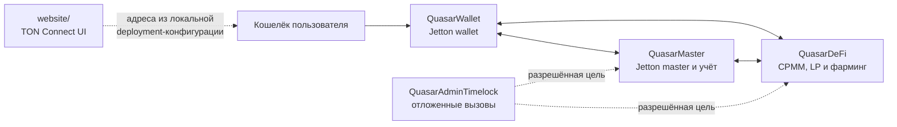

# QUASAR

> Предзапусковой прототип Jetton и DeFi для TON. Канонические смарт-контракты проекта написаны на **Tolk** и собираются инструментарием **Acton 1.2.1**.

[](https://github.com/Alexkkkkk/QUASAR/actions/workflows/ci.yml)
[](https://ton.org)
[](https://docs.ton.org/tolk/overview)
[](LICENSE)

> [!WARNING]
> **Проект не запущен в production и не прошёл независимый аудит.** Не отправляйте реальные средства и не воспринимайте расчётные награды, APY или другие показатели как обещание доходности. До развёртывания обязательны отдельная репетиция в testnet, план перехода состояния и независимый аудит текущего Tolk-поколения.

> [!IMPORTANT]
> Tolk-контракты — **новое поколение**, а не обновление существующих Tact-контрактов. Их код, схема состояния, `StateInit` и адреса отличаются. Состояние и адреса старого поколения нельзя считать совместимыми с новыми контрактами.

## Что такое QUASAR

QUASAR — прототип токена QSR и связанных TON-контрактов. Репозиторий содержит Jetton master и wallets, CPMM-пул QSR/TON, учёт ликвидности и LP, фарминг, стейкинг, вестинг, реферальный учёт и административные механизмы. В системе также присутствует ограниченный интерфейс для действий AI Oracle; наличие такого кода не означает, что автономный агент включён или безопасен.

Веб-интерфейс находится в `website/`. Без корректной конфигурации развёртывания адреса контрактов не загружаются, а транзакционные действия остаются отключёнными. В репозитории нет опубликованной конфигурации `website/deployment.json`; этот файл намеренно исключён из Git.

**Ссылки:** [статус аудита](docs/AUDIT_STATUS.md) · [решение о миграции на Tolk](docs/TOLK_MIGRATION_DECISION.md) · [проверка готовности к mainnet](docs/MAINNET_READINESS_CHECKLIST.md) · [вклад в проект](docs/CONTRIBUTING.md)

## Текущая архитектура



| Контракт | Исходник | Назначение |
| --- | --- | --- |
| `QuasarMaster` | [`tolk/contracts/QuasarMaster.tolk`](tolk/contracts/QuasarMaster.tolk) | Jetton master, выпуск и учёт QSR, комиссии, стейкинг, вестинг, referral и административная логика. |
| `QuasarWallet` | [`tolk/contracts/QuasarWallet.tolk`](tolk/contracts/QuasarWallet.tolk) | Jetton wallet; общий wallet-код подключается master и DeFi. |
| `QuasarDeFi` | [`tolk/contracts/QuasarDeFi.tolk`](tolk/contracts/QuasarDeFi.tolk) | CPMM-пул, обмен, ликвидность, LP и учёт фарминга. |
| `QuasarAdminTimelock` | [`tolk/contracts/QuasarAdminTimelock.tolk`](tolk/contracts/QuasarAdminTimelock.tolk) | Отложенное исполнение административных вызовов. |

Точные сообщения, opcodes, поля и getters задаются исходниками Tolk и compiler-derived ABI snapshots в [`docs/abi/`](docs/abi/). Описание функций — не гарантия конкретного результата транзакции: проверяйте контрактное состояние, параметры и обработку отказов.

## Единственный активный toolchain контрактов

- **Язык контрактов:** Tolk.
- **Сборка, генерация ABI/wrappers и эмуляционные тесты:** Acton CLI `1.2.1`, закреплённый в [`tolk/Acton.toml`](tolk/Acton.toml).
- **Исходники проекта Acton:** `tolk/contracts/` и `tolk/tests/`.
- **ABI snapshots и интерфейсы:** `docs/abi/`; ABI создаётся и проверяется по результатам компиляции.
- **Единая контролируемая публикация локальных build-артефактов:** `scripts/sync_acton.py` и `tolk/build/synchronized/`.

Исторические Tact-файлы находятся только в [`docs/historical/tact-reference/`](docs/historical/tact-reference/). Они сохранены как свидетельства прежнего поколения, не входят в активную сборку и не являются альтернативным путём разработки.

## Разработка и локальная проверка

### Требования

- Node.js **22 или 24** и npm.
- Python **3.11+** с `pip`.
- Acton CLI **1.2.1**.

Сначала установите базовый Acton CLI по [официальной инструкции](https://ton-blockchain.github.io/acton/docs/installation), затем установите требуемую версию:

```sh
acton up 1.2.1
acton --version
node --version
python3 --version
```

`npm ci` устанавливает JavaScript-зависимости, но **не устанавливает Acton**. Python-зависимости тестов перечислены в `requirements.txt`.

### Проверка чистой рабочей копии

Из корня репозитория:

```sh
git clone https://github.com/Alexkkkkk/QUASAR.git
cd QUASAR
npm ci
python3 -m pip install -r requirements.txt
npm run acton:init
npm run lint
npm test
npx tsc --noEmit
npm run abi:verify
npm run abi:migration:check
npm run abi:dapp
python3 scripts/sync_acton.py --check
```

`npm run acton:init` инициализирует стандартную библиотеку Acton для проекта и сохраняет закреплённую версию в `tolk/Acton.toml`. `npm run lint` выполняет проверки форматирования, компиляцию, генерацию wrappers и проверки Acton. `npm test` запускает контролируемую сборку, security checks, Node.js и Python-регрессии. Для отдельного запуска эмуляционных тестов Tolk используйте:

```sh
npm run test:tolk
```

### Основные команды

| Команда | Назначение |
| --- | --- |
| `npm run build` | Собрать изолированное поколение Tolk, проверить его и атомарно опубликовать локальные артефакты. |
| `python3 scripts/sync_acton.py --check` | Проверить согласованность исходников и опубликованного build-поколения без его перестройки. |
| `npm run abi:verify` | Сверить compiler-derived ABI с зафиксированными snapshots. |
| `npm run abi:migration:check` | Сравнить выбранные wire-level интерфейсы исторического и текущего поколений; это не проверка поведенческой или storage-эквивалентности. |
| `npm run abi:dapp` | Проверить интерфейс сайта относительно контрактного ABI. |
| `npm run security:check` | Запустить локальные security-инварианты репозитория. Это не независимый аудит. |
| `npm run deployment:check` | Проверить локальную конфигурацию deployment, если она существует. Отсутствие файла не означает, что контракт развёрнут. |
| `npm run website` | Локально раздать статические файлы каталога `website/`. |

Другие обязательные проверки перед изменениями перечислены в [`docs/CONTRIBUTING.md`](docs/CONTRIBUTING.md) и CI.

## CI и автоматизация GitHub

При изменениях в pull request запускается минимальный Acton/Tolk pipeline:
`acton doctor`, `fmt --check`, GitHub lint annotations, build, wrapper generation
и native tests. Scheduled/manual workflow отдельно формирует coverage, gas и
mutation reports. Manual и unattended auto-fix workflows создают только patch
artifact или изолированный PR и не меняют `main`.

Все legacy AI, dApp, release, Dependabot, triage, swarm и auto-merge Actions
удалены. Deployment, подпись транзакций и on-chain операции не автоматизируются.

## ABI, сборка и совместимость

Snapshots в `docs/abi/` помогают заметить изменения внешнего интерфейса: сообщений, полей и методов. Build-скрипт использует закреплённый генератор TypeScript wrappers и публикует артефакты после успешного прохождения проверок. Локальные результаты сборки не являются опубликованным deployment.

Проверка ABI или совпадение build hashes сами по себе **не доказывают**:

- эквивалентность всех ветвей поведения старому поколению;
- совместимость или автоматический перенос storage;
- сохранение прежних адресов контрактов и Jetton wallets;
- готовность к работе с реальными активами.

Любое изменение контрактной логики, wire format, авторизации, учёта активов, bounce-пути или storage требует целевых регрессионных тестов и рассмотрения рисков в PR.

## Статус запуска и безопасность

QUASAR — предзапусковой инженерный прототип. По состоянию репозитория отсутствуют официальные адреса Tolk-контрактов и tracked `website/deployment.json`; функциональный smoke-run в testnet и независимый аудит Tolk-поколения остаются отдельными release gates.

До любого реального развёртывания нужны, как минимум:

1. Проверка чистой и воспроизводимой сборки конкретного release commit, ABI, wrappers и code hashes.
2. Отдельно утверждённый план перехода для supply, пользовательских балансов, custody, LP/farm-позиций, staking, vesting, referral-обязательств и незавершённых выплат.
3. Репетиция в тестовой сети, включая успешные, отказные и bounce-сценарии.
4. Независимый аудит итоговых исходников, артефактов, сообщений и плана перехода.
5. Проверенные адреса и операционные процедуры для admin, emergency, treasury и oracle-ключей.

Не сохраняйте в репозитории seed-фразы, закрытые ключи, `.env`, реальные deployment state или пользовательские секреты. Не используйте реальные средства при локальной разработке. Сборка и тесты этого репозитория не выполняют deploy, подпись, broadcast или миграцию активов.

Подробный release gate: [`docs/MAINNET_READINESS_CHECKLIST.md`](docs/MAINNET_READINESS_CHECKLIST.md). Сообщать об уязвимости следует через приватный security-канал GitHub, а не публиковать эксплойт в открытой issue.

## Полезные материалы

- [`tolk/README.md`](tolk/README.md) — детали Tolk/Acton build pipeline.
- [`docs/TON_CONFORMANCE_MATRIX.md`](docs/TON_CONFORMANCE_MATRIX.md) — матрица стандартов TON и проверок.
- [`docs/abi/README.md`](docs/abi/README.md) — устройство ABI snapshots.
- [`docs/AUDIT_STATUS.md`](docs/AUDIT_STATUS.md) — журнал статуса аудита и исторических finding'ов.
- [`docs/TESTNET_DEPLOY_CHECKLIST.md`](docs/TESTNET_DEPLOY_CHECKLIST.md) — checklist тестового развёртывания.
- [`docs/TESTNET_SMOKE_RUNBOOK.md`](docs/TESTNET_SMOKE_RUNBOOK.md) — testnet smoke-runbook.
- [`docs/CONTRIBUTING.md`](docs/CONTRIBUTING.md) — правила разработки и CI-проверки.

## Лицензия

Проект распространяется по лицензии [MIT](LICENSE). Лицензия не является гарантией безопасности кода, доступности сети или сохранности средств.
