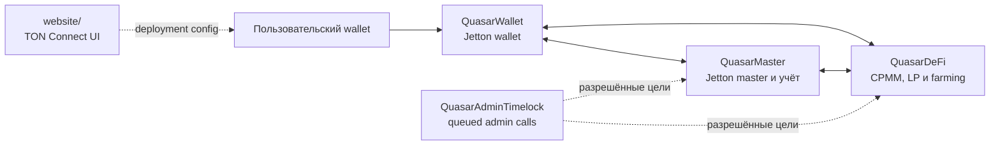

# QUASAR

> Предзапусковой прототип Jetton и DeFi для TON. Канонические smart contracts проекта написаны на **Tolk** и собираются закреплённым **Acton 1.2.1**.

[](https://github.com/Alexkkkkk/QUASAR/actions/workflows/ci.yml)
[](https://github.com/Alexkkkkk/QUASAR/actions/workflows/security-depth.yml)
[](https://ton.org/)
[](https://docs.ton.org/tolk/overview)
[](LICENSE)

> [!WARNING]
> **QUASAR не запущен в production и не прошёл независимый внешний аудит.** Не отправляйте реальные средства и не воспринимайте APY, rewards или другие расчётные показатели как обещание доходности. До deployment обязательны testnet rehearsal, review плана перехода и независимый аудит.

> [!IMPORTANT]
> Активное поколение контрактов — только Tolk/Acton. Оно не является автоматически совместимым со старым поколением: отличаются код, storage schema, `StateInit`, адреса и ABI. Нельзя считать старые адреса или состояние совместимыми без отдельного migration plan.

## Содержание

- [О проекте](#о-проекте)
- [Статус и границы](#статус-и-границы)
- [Архитектура](#архитектура)
- [Структура репозитория](#структура-репозитория)
- [Быстрый старт](#быстрый-старт)
- [Локальные проверки](#локальные-проверки)
- [CI и security pipeline](#ci-и-security-pipeline)
- [ABI и совместимость](#abi-и-совместимость)
- [Deployment safety](#deployment-safety)
- [Reference-материалы](#reference-материалы)
- [Вклад в проект](#вклад-в-проект)
- [Лицензия и безопасность](#лицензия-и-безопасность)

## О проекте

QUASAR — инженерный прототип QSR и связанных TON-компонентов. В репозитории находятся:

- Jetton master и wallets;
- CPMM-пул QSR/TON, liquidity и LP accounting;
- staking, farming, vesting и referral accounting;
- административный timelock;
- ограниченный интерфейс AI Oracle для подписанных/управляемых действий;
- статический web UI с TON Connect интеграцией.

Наличие AI Oracle-кода не означает, что автономный агент включён, безопасен или готов к production. On-chain действия должны рассматриваться как отдельная security-critical поверхность.

## Статус и границы

| Область | Текущее состояние |
| --- | --- |
| Язык контрактов | Tolk |
| Toolchain | Acton 1.2.1, закреплён в `tolk/Acton.toml` |
| Production deployment | Нет опубликованных официальных адресов |
| Deployment config | `website/deployment.json` отсутствует намеренно |
| Независимый аудит | Не завершён |
| Legacy Tact sources | Удалены из активного репозитория |
| CI deployment/broadcast | Не выполняется |

Сборка, тесты и deployment preflight не подписывают транзакции, не отправляют сообщения в сеть и не выполняют migration активов.

## Архитектура



### Контракты

| Контракт | Исходник | Назначение |
| --- | --- | --- |
| `QuasarMaster` | [`tolk/contracts/QuasarMaster.tolk`](tolk/contracts/QuasarMaster.tolk) | Jetton master, supply, mint/burn, fees, staking, vesting, referrals и governance/AI hooks. |
| `QuasarWallet` | [`tolk/contracts/QuasarWallet.tolk`](tolk/contracts/QuasarWallet.tolk) | Jetton wallet, TEP-74 transfer/burn/notification paths и bounce-safe accounting. |
| `QuasarDeFi` | [`tolk/contracts/QuasarDeFi.tolk`](tolk/contracts/QuasarDeFi.tolk) | CPMM, swaps, liquidity, LP positions, farming и deferred payouts. |
| `QuasarAdminTimelock` | [`tolk/contracts/QuasarAdminTimelock.tolk`](tolk/contracts/QuasarAdminTimelock.tolk) | Delayed/cancellable administrative calls с проверкой targets и storage. |
| Shared records | [`tolk/contracts/QuasarCommon.tolk`](tolk/contracts/QuasarCommon.tolk) и [`tolk/contracts/QuasarMasterRecords.tolk`](tolk/contracts/QuasarMasterRecords.tolk) | Общие сообщения, wire layouts и serializable records. |

Точные сообщения, opcodes, поля и getters определяются исходниками Tolk и compiler-derived ABI snapshots в [`docs/abi/`](docs/abi/). Описание функции не заменяет проверку фактического состояния, параметров и отказных/bounce-сценариев.

## Структура репозитория

```text
QUASAR/
├── tolk/
│   ├── Acton.toml                 # Закреплённый Acton 1.2.1 manifest
│   ├── contracts/                 # Канонические Tolk-контракты
│   ├── tests/                     # Acton emulator/regression/fuzz tests
│   └── build/synchronized/        # Контролируемые generated artifacts
├── scripts/
│   ├── sync_acton.py              # Build и атомарная синхронизация artifacts
│   ├── security_check.ts          # Source-level security invariants
│   ├── acton_abi.py               # ABI snapshot verification
│   └── check_dapp_abi.ts          # Website/ABI compatibility check
├── tests/                         # Node.js и Python tooling tests
├── website/                       # TON Connect UI; deployment config не tracked
├── docs/abi/                      # Reviewed compiler-derived ABI snapshots
├── docs/proposals/                # Неактивные reference/draft материалы
└── .github/workflows/             # CI, tests, CodeQL и security-depth
```

`docs/proposals/` не является источником активных контрактов. Draft-код из этого каталога не должен подключаться к Acton build без отдельного port, compilation, ABI review и regression suite.

## Быстрый старт

### Требования

- Node.js 22 или 24;
- npm 11;
- Python 3.11+;
- Acton CLI 1.2.1;
- Git.

Установите Acton по [официальной инструкции](https://ton-blockchain.github.io/acton/docs/installation), затем проверьте версию:

```sh
acton up 1.2.1
acton --version
node --version
python3 --version
```

### Установка и smoke check

```sh
git clone https://github.com/Alexkkkkk/QUASAR.git
cd QUASAR
npm ci
python3 -m pip install -r requirements.txt
npm run acton:init
npm run lint
npm test
```

`npm ci` устанавливает JavaScript-зависимости, но не устанавливает Acton. `npm run acton:init` обновляет только стандартную библиотеку Acton. Версия CLI закреплена в `tolk/Acton.toml`; команда её не переписывает и не подменяет CLI.

## Локальные проверки

### Основные команды

| Команда | Назначение |
| --- | --- |
| `npm run build` | Собрать Tolk-поколение, проверить его и синхронизировать generated artifacts. |
| `npm run lint` | Проверить форматирование, build, wrappers и Acton checks. |
| `npm test` | Выполнить build, source security checks, Node.js и Python regression suites. |
| `npm run test:tolk` | Запустить Acton emulator tests. |
| `npm run test:tolk:fuzz` | Запустить воспроизводимый Acton fuzz suite с seed `20261024`. |
| `npm run test:tolk:coverage` | Запустить coverage с текущим floor 50%. Это инженерный gate, не audit rating. |
| `npm run test:tolk:mutation` | Запустить critical mutation testing для `QuasarMaster`. |
| `npm run security:check` | Проверить source-level invariants wallet/master/DeFi/timelock и dApp safety. |
| `npm run abi:verify` | Сверить compiler-derived ABI с snapshots в `docs/abi/`. |
| `npm run abi:dapp` | Проверить opcode map и website integration против ABI. |
| `python3 scripts/sync_acton.py --check` | Проверить, что tracked generated artifacts синхронизированы. |
| `npx tsc --noEmit` | Проверить типы TypeScript scripts/tests. |
| `npm run deployment:check` | Проверить локальный deployment artifact, если он существует. |
| `npm run deployment:preflight` | Полный release preflight: build, security, ABI, hashes и deployment wrappers. |
| `npm run website` | Запустить статический web UI локально. |

### Рекомендуемый полный локальный gate

```sh
npm run lint
npm test
npm run test:tolk:fuzz
npm run test:tolk:coverage
npm run test:tolk:mutation
npx tsc --noEmit
npm run abi:verify
npm run abi:dapp
python3 scripts/sync_acton.py --check
```

Coverage и mutation testing измеряют качество тестов и устойчивость к изменениям; они не заменяют threat model, code review, formal review или независимый аудит.

## CI и security pipeline

Каждый PR в `main` проходит несколько независимых слоёв:

| Workflow/check | Что проверяет |
| --- | --- |
| `QUASAR CI / review` | Tolk-only repository invariants и отсутствие legacy contract/parity surface. |
| `QUASAR CI / validate` | Formatting, build, generated artifacts, contracts, ABI, dApp map, TypeScript и dependency audit. |
| `QUASAR Tests / contracts` | Acton build/security checks, Node.js contract tooling и Python regressions. |
| `QUASAR Tests / dApp` | dApp unit tests и production build. |
| `QUASAR Tests / python` | Python test suite. |
| `CodeQL` | Static analysis для JavaScript/TypeScript и Python. |
| `QUASAR security depth` | Seeded fuzzing, coverage floor 50%, critical mutation testing Master и downloadable reports. |

Основные workflow-файлы:

- [`ci.yml`](.github/workflows/ci.yml) — required `review` и `validate` checks;
- [`_checks.yml`](.github/workflows/_checks.yml) — shared validation job;
- [`tests.yml`](.github/workflows/tests.yml) — contracts/dApp/Python matrix;
- [`security-depth.yml`](.github/workflows/security-depth.yml) — углублённые security gates;
- [`dapp-ci.yml`](.github/workflows/dapp-ci.yml) — отдельная dApp проверка;
- [`ton-docs-sync.yml`](.github/workflows/ton-docs-sync.yml) — проверка синхронизации TON Docs.

CI не публикует сайт, не деплоит контракты, не подписывает транзакции и не выполняет on-chain операции.

## ABI и совместимость

ABI snapshots в [`docs/abi/`](docs/abi/) фиксируют внешний интерфейс: messages, fields, opcodes и getters. Build pipeline генерирует wrappers и artifacts только после успешной компиляции.

Успешный ABI check или совпадение build hashes **не доказывают**:

- storage compatibility;
- совпадение адресов и `StateInit`;
- поведенческую эквивалентность всех ветвей;
- корректность migration активов;
- mainnet readiness.

Любое изменение авторизации, token accounting, wire format, bounce path, storage или upgrade logic должно сопровождаться целевыми тестами и отдельным review риска.

## Deployment safety

Официальные deployment addresses и tracked `website/deployment.json` отсутствуют. Поэтому web UI не должен считаться подключённым к production contracts.

Перед любым testnet/mainnet deployment необходимы:

1. чистая воспроизводимая сборка конкретного release commit;
2. ABI, wrappers и code-hash review;
3. testnet rehearsal успешных, отказных и bounce-сценариев;
4. отдельный migration/state-transition plan;
5. проверка admin, guardian, treasury и oracle keys;
6. независимый security audit;
7. подписанное решение о выпуске.

Для release-проверки используйте:

```sh
npm run deployment:preflight
```

Эта команда не подписывает и не отправляет транзакции. Не храните в репозитории seed-фразы, private keys, `.env`, реальные deployment state или пользовательские секреты.

## Reference-материалы

В `docs/proposals/` сохранены материалы, предоставленные как drafts/reference:

- [`README_SECURITY_REFERENCE_DRAFT.md`](docs/proposals/README_SECURITY_REFERENCE_DRAFT.md);
- [`QUASAR_MASTER_TOLK_1_4_SINGLE_FILE_DRAFT.tolk`](docs/proposals/QUASAR_MASTER_TOLK_1_4_SINGLE_FILE_DRAFT.tolk);
- [`QUASAR_MASTER_TOLK_1_4_ACTON_TEST_SYNTHESIS.md`](docs/proposals/QUASAR_MASTER_TOLK_1_4_ACTON_TEST_SYNTHESIS.md).

Они полезны для review идей и threat-model discussion, но не являются активным source generation. В частности, упоминания Tolk 1.4, неподтверждённого `mutate` syntax или альтернативных Acton manifest settings нельзя считать поддержанными текущим toolchain без отдельной компиляции и migration review.

## Вклад в проект

Перед PR:

1. изменяйте канонические Tolk-исходники, а не generated artifacts;
2. добавляйте regression test для нового поведения и отказных путей;
3. запускайте локальный полный gate из этого README;
4. проверяйте ABI snapshots и dApp opcode map;
5. описывайте storage, authorization, bounce и deployment implications;
6. не добавляйте deployment, signing или broadcast automation без отдельного решения.

Подробнее: [`docs/CONTRIBUTING.md`](docs/CONTRIBUTING.md).

## Полезные документы

- [`tolk/README.md`](tolk/README.md) — детали Acton/Tolk build pipeline;
- [`docs/AUDIT_STATUS.md`](docs/AUDIT_STATUS.md) — текущий audit status;
- [`docs/SECURITY_AUDIT.md`](docs/SECURITY_AUDIT.md) — security audit notes;
- [`docs/TON_CONFORMANCE_MATRIX.md`](docs/TON_CONFORMANCE_MATRIX.md) — TON standards и conformance checks;
- [`docs/MAINNET_READINESS_CHECKLIST.md`](docs/MAINNET_READINESS_CHECKLIST.md) — release/mainnet checklist;
- [`docs/STATE_MIGRATION_PLAN.md`](docs/STATE_MIGRATION_PLAN.md) — state snapshot, claim, reconciliation, rollback и go/no-go plan;
- [`docs/MIGRATION_SNAPSHOT_TOOL.md`](docs/MIGRATION_SNAPSHOT_TOOL.md) — fail-closed snapshot hash, reconciliation и Merkle-root tooling;
- [`docs/TESTNET_DEPLOY_CHECKLIST.md`](docs/TESTNET_DEPLOY_CHECKLIST.md) — testnet rehearsal checklist;
- [`docs/TESTNET_SMOKE_RUNBOOK.md`](docs/TESTNET_SMOKE_RUNBOOK.md) — testnet smoke runbook;
- [`docs/MULTISIG_HANDOFF_RUNBOOK.md`](docs/MULTISIG_HANDOFF_RUNBOOK.md) — multisig handoff procedures;
- [`website/`](website/) — TON Connect web UI.

## Лицензия и безопасность

Проект распространяется по [MIT License](LICENSE).

Для сообщения об уязвимости используйте приватный security-канал GitHub. Не публикуйте рабочий exploit или секреты в открытых issues и pull requests.
